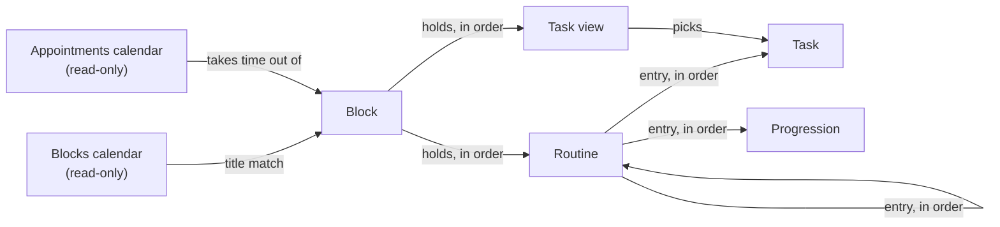
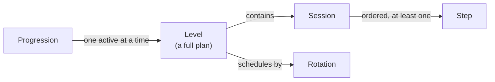
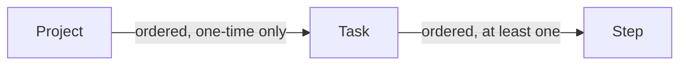
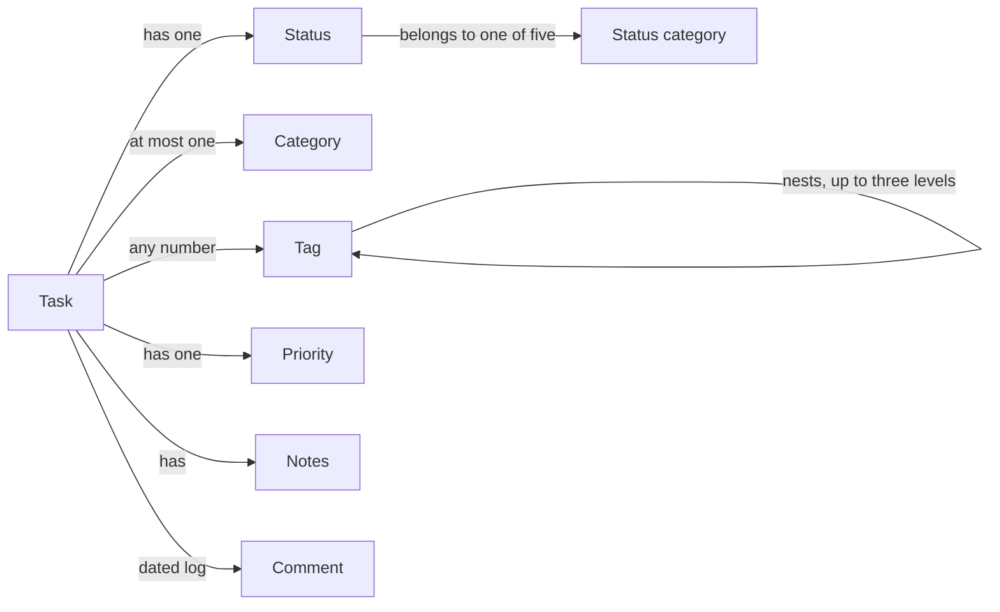
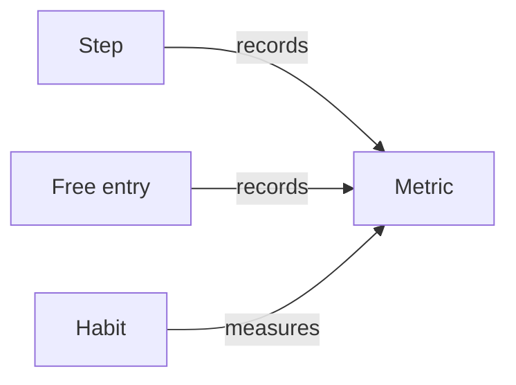
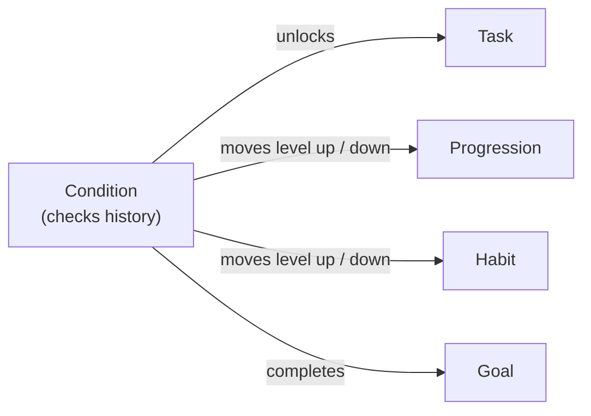
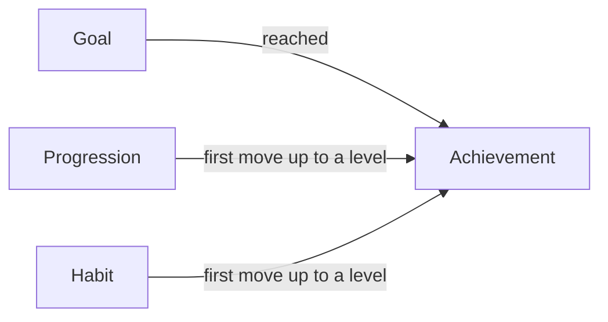

# Domain Model

The task is the center of the domain. Blocks, routines, task views, and progressions arrange tasks. Steps inside tasks record metrics. Habits measure metrics after the fact.

## Overview

### How work reaches your day



Any routine entry can loop a set number of times.

You can also run any routine or task on demand, without the calendar.

### Inside a progression



### Inside a project and a task



Any step can loop a set number of times.

### Task fields



### Metrics and habits



### What conditions drive



### Achievements



Modes: guided or manual.

## Settled

### Calendar

The calendar holds your schedule. Run My Day reads it and never changes it.

Each connected calendar is a blocks calendar or an appointments calendar. An event on a blocks calendar starts a block. An event on an appointments calendar is an appointment, such as a dentist visit. Run My Day warns you before each appointment, and a running routine pauses during it.

An appointment takes precedence over a block. An appointment that overlaps a block takes its time out of the block, so the block has less room for work.

```text
Workout block   09:00 ------------------------------ 10:00   (60 min)
Dentist                     09:30 -------- 09:45
room for work:  45 min
```

### Block

A block attaches work to the calendar from the top down. A calendar event starts the block whose title matches the event title. A block holds an ordered list of routines and task views. A block never holds a task directly.

A block runs its list in order. The list can hold the same task view more than once. Each time a view appears again, it continues where it left off. This interleaves views inside one block, so you don't need many small blocks on the calendar. A block can repeat its list until the block ends. A repeating block stops early when no view in its list has a task left to pick.

A task view can have a limit: a number of tasks, a number of steps, or a number of minutes. Each appearance of the view in a block ends when its limit is reached. A minutes limit ends at a step boundary, at whichever comes first: the time is up, or the next step's estimate does not fit in the time left. A step is never cut off, and a view switches early rather than run over. The first step of each appearance always starts, so a step longer than the limit still runs. A task that a limit stops partway resumes at its next incomplete step when the view appears again. A view without a limit runs until it has no more tasks to pick. A view that has no more tasks to pick is passed over.

Two views:

```text
Email view: limit 1 task       Paperwork view: limit 1 task
Admin block: Email, Paperwork, Email, Paperwork, Email, Paperwork

run:  E1  P1  E2  P2  E3  P3
```

Three views, each with its own kind of limit:

```text
Deep work view: limit 3 steps   Email view: limit 1 task   Errands view: limit 10 min
Work block: Deep work, Email, Errands, Deep work, Email, Errands

run:  D1(steps 1-3)  E1  R1 R2 (10 min)  D1(steps 4-5) D2(step 1)  E2  R3 ...
```

A minutes limit switches early:

```text
Errands view: limit 10 min

0 min   step A (4 min)
4 min   step B (3 min)
7 min   next step C is 5 min, only 3 min left -> switch now, C waits
```

A view that runs out:

```text
Paperwork view has only P1
Admin block: Email, Paperwork, Email, Paperwork, Email

run:  E1  P1  E2  E3   (Paperwork is passed over the second time)
```

### Routine

A routine is an ordered list of entries that repeats. Each entry is a task, a progression, or another routine. A routine holds no steps of its own. A routine inside a routine works as a section, such as a morning cleaning routine inside the morning routine, and lets you reuse it. A routine can belong to many blocks and many routines. A routine can never contain itself, directly or through other routines. Any routine entry can loop a set number of times, such as 4 rounds of a circuit routine.

A task that a stopped routine did not reach stays due. It plays at the routine's next run and shows wherever due and overdue tasks show. A routine keeps no list of leftovers.

Each entry plays only when its own schedule says:

| Entry | Plays when |
| --- | --- |
| Task with a due date, one-time or recurring | its due date is today or earlier |
| Task without a due date | every time, until you complete it |
| Progression | the active level's rotation has a session due |
| Routine | every time. Its own entries decide what plays |

```text
Morning routine, runs daily
  Water plants   repeats Mon, Wed, Fri
  Pay rent       one-time, due Dec 1

Mon  Water plants plays; you complete it -> next due Wed
Tue  Water plants does not play
Wed  Water plants plays
Dec 1  Pay rent plays, and keeps playing until you complete it
```

Loops nest. Each loop of a routine entry runs every one of its entries in order, with their own loops, all the way down to the steps. Estimates multiply the same way.

```text
Workout routine
  Circuit routine            x 3 loops
    Push-up task
      Step "10 push-ups"     x 2 loops

run order:  round 1: push-ups, push-ups
            round 2: push-ups, push-ups
            round 3: push-ups, push-ups   -> step runs 6 times
estimate:   step estimate x 2 x 3
```

### Task view

A task view is a saved filter and sort over tasks. It is the only way a task outside a routine reaches a block. A filter can include or exclude tasks that belong to a routine.

### Task

A task is the center of the domain. A task holds an ordered list of steps and always has at least one step. A task's estimate is the sum of its steps' estimates. A recurring task comes back on its own schedule.

A task can have a due date, with an optional due time. A due time follows the clock: "due Friday 02:00" means 02:00 on calendar Friday. A due date without a time lasts until your day ends: with the day starting at 4:00, "due Friday" ends at 4:00 on Saturday. A "day starts at" setting, 4:00 by default, decides which date counts as today for every day rule, such as due today and repeats. Every day rule uses the time zone stored in your settings.

```text
Day starts at 4:00. It is 1:00 on calendar Friday, and you are still up from Thursday.

"due Thu"         (no time)  -> still due today; your Thursday ends at 4:00
"due Fri"         (no time)  -> due tomorrow, your Friday
"due Fri 02:00"   (time)     -> due in 1 hour, by the clock
```

A recurring task is one task whose due date moves forward each time you complete or skip it. A missed recurring task stays overdue until you complete it, skip it, or move its due date yourself.

A recurring task's repeat builds on TickTick's repeat model. The [task settings guide](task-settings-guide.md) explains each setting with examples.

A repeat has one pattern kind:

- **Every N days, weeks, months, or years**, repeating by due date or by completion date.
- **Specific dates**, repeating by due date.

A repeat by due date sets the next due date from the old due date. A repeat by completion date sets it from when you finished.

A repeat by due date has an "if missed" setting. **Jump to today**, the default, moves the due date to the next pattern date after today. **Every date is owed** moves it to the next pattern date after the old due date.

A repeat ends never, on a date, or after a number of repeats.

A task has one status. Each status belongs to one of five fixed categories: backlog, ready, started, complete, and canceled. You can add and rename statuses inside each category. Domain rules read only the category. Task view filters can pick a single status or a whole category.

Run My Day ships these statuses:

| Category | Statuses |
| --- | --- |
| backlog | Ideas, Future |
| ready | Ready |
| started | Started, Waiting |
| complete | Complete |
| canceled | Canceled, Duplicate |

Waiting means waiting on someone else. Its due date is the follow-up date. A new task is ready. You move a task to backlog, or create it as backlog, when you don't plan to do it soon or it has no due date yet.

A task has one priority from a fixed set: no priority, low, medium, high, or urgent. A new task has no priority.

A task has at most one category and any number of tags. Categories and tags help you filter and sort tasks. Categories have an order you set. Tags have an order you set. Tags can nest up to three levels deep. A filter on a parent tag also matches tasks tagged with any tag nested under it.

```text
Home
+-- Garden
|   +-- Watering      "Water plants" is tagged Home/Garden/Watering
+-- Kitchen

filter on "Home"   -> matches "Water plants"
filter on "Garden" -> matches "Water plants"
```

A task has notes: one Markdown text that holds the current facts. A task also has comments: a dated log of entries, each of which can hold images.

A task's skip count is the number of times you skipped it since you last completed it. Run My Day computes it from history.

Tasks have no subtasks. To break work down, you split a task into several tasks in the same place.

### Project

A project is an ordered list of one-time tasks that you create as a project yourself. A project grows as you learn: you add tasks you could not foresee, reorder them, and split tasks into smaller tasks. A project never contains a recurring task. The depth is always project, then task, then step.

A project's tasks run in their set order. A later task waits for the earlier ones without any stored condition. Waiting tasks stay visible as "up next" and are never hidden. A project's estimate is the sum of its tasks' estimates.

A project can have a start date. Its tasks stay hidden until that date.

### History

History is the record of every action taken in Run My Day, such as completing a task, skipping a task, moving a due date, or logging a metric value. History belongs to no single entity.

History also records every edit to a definition, such as a change to a level, a session, or a step. Any definition as it was at any past moment therefore follows from history. Editing a definition never changes what history says about the past.

### Condition

A condition is a check against your history of completions, metric values, and dates. Unlock conditions, habits, goals, and progression levels all use the same condition concept.

### Unlock conditions

Any task, one-time or recurring, can have a list of unlock conditions. Most tasks have none: order covers the common case, and unlock conditions handle exceptions such as a dependency on a task in another project or a metric. Each task chooses whether it unlocks when all of its conditions are met or when any one of them is met. A locked task stays hidden until it unlocks. A condition can be:

- another task completed a set number of times, including once
- a metric condition

A task has no start date. A project can have one instead.

A condition lives on the thing whose state it changes. A task carries its own unlock conditions. Anything that chooses between tasks belongs to a progression.

Conditions can never be circular: no task can wait on itself.

Run My Day refuses to delete anything that an unmet condition points at, such as a level that an unreached goal points at, or a task that another task's unlock condition points at.

### Progression

A progression is an ordered list of levels. Each level is a whole training plan: a set of sessions and one rotation for them, over any span of days or weeks. For example, a push-up progression starts at 10 push-ups twice a week. It moves to four times a week, then to changing sets and reps, then to a two-week rotation of push-up types such as handstand push-ups one day and triangle push-ups another. Each level is a full plan on its own and lists all of its sessions and its rotation. Exactly one level is active at a time.

### Session

A session is a planned bout of practice inside a progression level, such as "Tree pose" or "Wide push-ups". A session has a title, steps, and an estimate, and its steps record metrics, the same as a task. A session is not a task: it has no repeat, no due date, no unlock conditions, and no place in a project or a task view. The level decides when a session is due. You can also run a session on demand.

A session belongs to exactly one level of one progression. When two levels or two progressions use the same exercise, each has its own session with its own history. Progress across them is tracked through a shared metric, such as "Tree hold, seconds".

### Rotation

A level's schedule is a rotation: an ordered list of slots, where each slot plays one of the level's sessions or is a rest day. For example, a 14-day rotation of standing postures with 2 rest days. Rotations exist only on progression levels.

A rotation starts at its first slot on the day its level becomes active. A rotation waits for you: a missed slot stays due until you do it, and every later slot shifts by a day. A rest slot passes when a day passes. A skip on a session means "not today": the rotation stays on the same slot, and history records the skip.

### Levels in your day

- The active level's sessions come due when its rotation says, and their completions count toward the progression's conditions.
- Inactive levels' sessions are hidden everywhere except the progression editor. A move back down to a level makes that level's same sessions active again.

Blocks offer chances, and schedules decide whether something plays at each chance. Blocks reserve time, and schedules decide what to do.

A progression reaches your day only through a routine. A routine entry can be a progression. That entry plays the active level's session due that day and is skipped on a rest slot. The routine itself does not change when the level changes.

Each level has move-up and move-down conditions, and the progression changes levels automatically when they pass. Sessions carry no level logic.

A level's number is its position in the progression's order. Goals and conditions point at a level itself, never at its number. Adding or reordering levels renumbers them, and each goal and condition still points at the same level. The active level stays active when levels are added around it. A move up goes to the next level in the current order. Every level stays editable, including reached levels.

```text
before                          after inserting "3x a week"
L1  2x a week                   L1  2x a week
L2  4x a week   <- active       L2  3x a week   (new)
L3  sets/reps   <- goal         L3  4x a week   <- still active
                                L4  sets/reps   <- goal still points here
```

A move up waits while the new level would not fit in the blocks that run it. The move happens once the blocks have room.

### Step

A step is a small unit of work inside a task or a session. Steps run in order. Every step has an estimate. A step can record a metric value. Metrics attach to steps, not tasks.

#### Running steps

Exactly one step is current at a time. It stays current until you confirm it done, its time runs out without "wait for done", you skip it, a view limit ends at its boundary, or an interruption stops it. You complete steps one at a time, wherever the task runs: in a routine, from a task view, or on demand.

Each step has a "wait for done" setting. In guided mode, a step without it moves to the next step when its time runs out. A step with it counts into overtime until you confirm it is done. Confirming sets the step's real end time. The last step of a task follows its own setting too, so a task whose last step does not wait for done completes when that step's time runs out.

```text
Pack gym bag, estimate 5 min, wait for done

0 -------- 5 min -------- 7:15
           countdown 0    you confirm done -> overtime +2:15, real time 7:15
```

Confirming done before a step's time runs out ends the step early, records its real time, and starts the next step.

```text
Dishes, estimate 10 min

0 ------ 6 min ------ 10 min
         you confirm done -> real time 6 min, next step starts now
```

#### Extend

Extend adds time to the current step's countdown for this run only. The step's estimate does not change. Its real time, including the extension, still feeds learned estimates. An extension can be any positive length, in seconds, minutes, or hours. Extending a step in overtime gives it that much time from now.

```text
Pack gym bag, estimate 5 min, wait for done

0 ------ 5 ------ 7 min      at +2:00 overtime you extend by 5 min
                  |--- 5 ---| countdown ends at 12 min
```

#### How a task ends

A step ends as done or skipped. An interrupted step is not ended: it resumes later. A task completes once every step is done or skipped and at least one step is done. A task whose every step was skipped counts as skipped, not complete. Skipping a task skips all its remaining steps at once, and the task then ends by the same rule. A task completes only through its steps, so every completion keeps its step statistics. A skip is an explicit choice, so history keeps it. A skipped step records no real time and does not feed learned estimates.

```text
Clean kitchen
  [x] Dishes     done
  [x] Counters   done
  [ ] Floor      <- you skip the task: Floor is skipped
                    2 done + 1 skipped -> task complete

Clean kitchen
  [-] Dishes     skipped
  [-] Counters   skipped
  [-] Floor      skipped  -> no step done -> task skipped
```

A partly done task is a state, not an outcome. A task keeps its completed steps when a run stops partway, and its next run starts at its first step that is not complete. A partly done task counts only its incomplete steps toward a block's room. When a recurring task completes, its steps start fresh for the next due date.

```text
Clean kitchen (estimate 25 min)
  [x] Dishes     10 min
  [x] Counters    5 min
  [ ] Floor      10 min   <- next run starts here; counts 10 min toward block room
```

#### Interruptions

A step tracks how much time has elapsed in it. A block end, an appointment, or your own stop can interrupt a running step. A view limit never does. A step that is running when its block ends stops at the block end. An interrupted step resumes later with its elapsed time, and its time left is its estimate minus its elapsed time. Every fit check uses a step's time left, not its full estimate. A loop's real time, which learned estimates use, is its total elapsed time across interruptions, without the time it sat paused. History records each interruption.

```text
Write report, step "Draft" (estimate 30 min)

Mon  Work block ends at 12 min   -> Draft stops, 12 min elapsed, 18 min left
Tue  Work block starts           -> Draft resumes at 12 min
     done at 31 min total        -> real time for learning: 31 min
```

#### Loops

A step can loop a set number of times, such as 3 sets of 10 push-ups. A step's estimate covers one loop. A looped step or a looped routine entry counts as its estimate multiplied by its loop count.

```text
Step "10 push-ups", estimate 2 min, x 3 loops -> counts as 6 min
```

#### Learned estimates

A step can learn its estimate. With learning on, a step's estimate is a trimmed average of the real times of its latest 5 completed loops: Run My Day drops the highest and the lowest time and averages the rest. Learning starts once a step has at least 3 completed loops. A task's or session's estimate stays the sum of its steps' estimates.

| Completed loops | Real times (min) | Kept | Estimate |
| --- | --- | --- | --- |
| 3 | 8, 10, 40 | 10 | 10 |
| 4 | 8, 10, 12, 40 | 10, 12 | 11 |
| 5 | 8, 9, 10, 12, 40 | 9, 10, 12 | 10.3 |

### Metric

A metric is a measured value. A step can record a metric value. You can also add, edit, or remove metric entries directly.

### Habit

A habit measures unplanned behavior after the fact. You log it when it happens, such as logging 24 oz each time you finish a water bottle. A habit's metric values come mostly from free entries, and sometimes from steps in tasks. A habit creates no tasks. A habit updates automatically from metric values. You never tick off a habit directly.

A habit can nudge you during the day based on how you are doing against its target, such as "30 of 60 oz, and it's 3 pm". Each habit sets how often it nudges, including never.

A habit differs from a progression in when the doing happens. A habit tracks behavior that life triggers. A progression plans scheduled work as tasks.

A habit can have levels. Each level sets a higher target, and conditions move the habit up or down automatically. For example, a water habit starts at 60 oz a day. After 7 days in a row at or above the target, it moves to 70 oz, then 80 oz, then 100 oz, which is the top level. A habit stays at its top level once it gets there. A habit level's number is its position. Goals and conditions point at a habit level itself, never at its number.

A habit measures its target over a sliding window of N days, weeks, months, or years. For example, "gym 3 times in any 7 days".

Each day passes or misses, based on the window that ends that day. The streak is the number of passing days in a row. The percentages are the share of passing days.

A habit shows:

- its current streak
- the percentage of successful days this week, this month, and this year

A level change never breaks a streak. Any day the target is not met breaks the streak.

A habit never finishes. Archiving a habit stops tracking. Unarchiving it shows its full history again, because Run My Day computes that history from the metric values.

### Goal

A goal is reached once and is then done. It completes the first time its conditions pass. A deadline is optional: some goals are for a lifetime. A goal with a deadline shows its pace: ahead, on track, or behind.

### Achievement

An achievement is a reached goal or a level move up in a progression or a habit. A goal becomes an achievement when its conditions pass. A move up becomes an achievement only the first time it reaches that level.

```text
Nov 1   L2 -> L3   achievement "Reached L3"
Nov 10  L3 -> L2   (move down)
Nov 20  L2 -> L3   no new achievement; history records the move
``` Each achievement has a trophy image. An achievement shows the conditions that were met, the history records that met them, and the level or goal as it was when reached.

Run My Day ships built-in goals with fixed conditions, such as a 30-day streak. A reached built-in goal becomes an achievement in the same way as your own goals.

### Modes

- **Guided mode:** the clock and your rules advance the day. Guidance comes through your choice of voice, sound cues, music cues, vibration, notifications, or silence.
- **Manual mode:** nothing advances by itself. You start and finish everything. Manual mode is also the way to take back control when the system gets something wrong.

You can start any routine or task on demand, outside the calendar, in either mode. Run My Day works without a blocks calendar.

### Unscheduled tasks

A task or session is unscheduled when Run My Day cannot show that it will get done by its due date. It is unscheduled in any of three ways:

- **No block:** no block's task view or routine can ever pick it.
- **Not on the calendar:** a block could pick it, but no event for that block comes before its due date.
- **Overbooked:** block events before its due date pick it, but the work ahead of it fills those events before it is reached.

Run My Day checks all three for each task that is overdue or due within the next 7 days. It checks a task without a due date only for no block. It checks a task due later than 7 days once its due date comes within 7 days. For an overdue task, "before its due date" means within the next 7 days. For a task in a project with a start date, only block events between the start date and the due date count. Run My Day skips a task that waits on a task or metric condition until it unlocks. It never checks a task in the backlog category, because a backlog task is intentionally not active.

```text
today: Nov 1                     Nov 8 (+7 days)
|--------------------------------|
  Renew tag, due Nov 4    -> checked: a block must reach it by Nov 4
  Pay rent, due Nov 20    -> not yet; checked from Nov 13
  Overdue: Call Joe       -> checked: a block must reach it by Nov 8
  Fix sink, no due date   -> checked for "No block" only
```

### Transitions

Work runs in small steps, so nothing gets cut off midway. Transition time between steps lets you catch your breath. Before something ends, Run My Day tells you what comes next and asks you to wrap up and leave the work in a good state. Run My Day encourages this practice and never enforces it.

