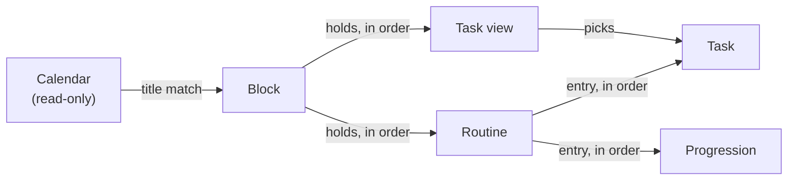
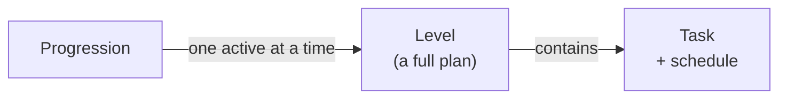
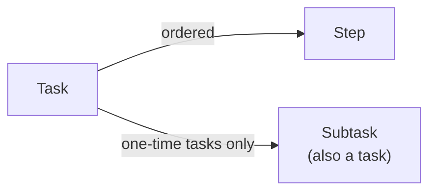
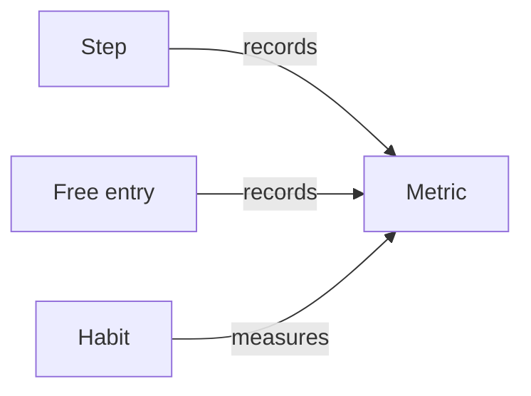
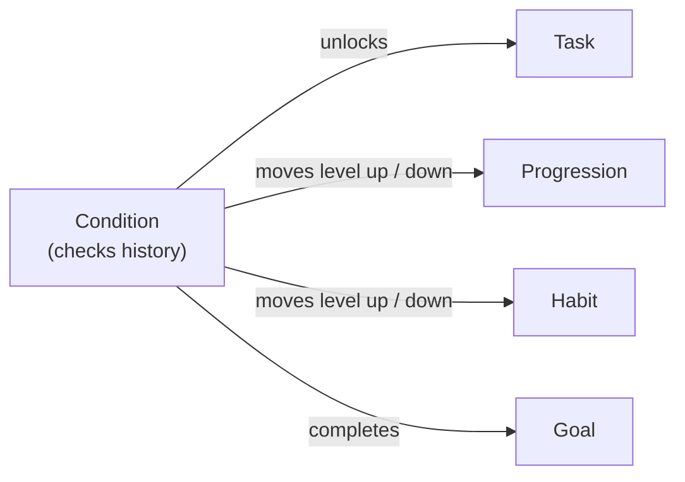

# Domain Model

The task is the center of the domain. Blocks, routines, task views, and progressions arrange tasks. Steps inside tasks record metrics. Habits measure metrics after the fact.

## Overview

### How work reaches your day

You can also run any routine or task on demand, without the calendar.

### Inside a progression

### Inside a task

### Metrics and habits

### What conditions drive

Modes: guided or manual.

## Settled

### Calendar

The calendar holds your schedule. Run My Day reads it and never changes it.

### Block

A block attaches work to the calendar from the top down. A calendar event starts the block whose title matches the event title. A block holds an ordered list of routines and task views. A block never holds a task directly.

### Routine

A routine is an ordered list of entries that repeats. Each entry is a task or a progression. A routine holds no steps of its own.

### Task view

A task view is a saved filter and sort over tasks. It is the only way a task outside a routine reaches a block. A filter can include or exclude tasks that belong to a routine.

### Task

A task is the center of the domain. A task holds an ordered list of steps. A task with no steps runs as a single step. A recurring task comes back on its own schedule.

A one-time task can hold one-time subtasks, nested to any depth you need. A recurring task never has subtasks and never sits inside another task.

### Project

A project is one-time work that you create or mark as a project yourself. A one-time task with subtasks stays a plain task until you mark it. A project grows as you learn: you add parts you could not foresee, reorder them, and break them down across as many levels as you need. A project never contains a recurring task.

Subtasks run in their set order. A later subtask waits for the earlier ones without any stored condition. Waiting subtasks stay visible as "up next" and are never hidden.

### Condition

A condition is a check against your history of completions, metric values, and dates. Unlock conditions, habits, goals, and progression levels all use the same condition concept.

### Unlock conditions

Any task, one-time or recurring, can have a list of unlock conditions. Most tasks have none: order covers the common case, and unlock conditions handle exceptions such as a dependency on a task in another project, a date, or a metric. Each task chooses whether it unlocks when all of its conditions are met or when any one of them is met. A locked task stays hidden until it unlocks. A condition can be:

- another task completed a set number of times, including once
- a metric condition
- a start date: the task stays hidden until that date

A condition lives on the thing whose state it changes. A task carries its own unlock conditions. Anything that chooses between tasks belongs to a progression.

Circular conditions are impossible. Run My Day refuses any condition that would make a task wait on itself.

### Progression

A progression is an ordered list of levels. Each level is a whole training plan: a set of recurring tasks, each with its own schedule and step targets, over any span of days or weeks. For example, a push-up progression starts at 10 push-ups twice a week. It moves to four times a week, then to changing sets and reps, then to a two-week rotation of push-up types such as handstand push-ups one day and triangle push-ups another. Each level is a full plan on its own and lists all of its tasks, schedules, and targets. Exactly one level is active at a time.

Each task in a level has a schedule. A schedule can be one of:

- **Fixed days:** such as Monday, Wednesday, and Friday.
- **Quota:** such as 2 sessions in any 7 days.
- **Cycle:** an ordered list of slots, where a blank slot is a rest day, such as a 2-week rotation of push-up types.
- **Interval:** such as every 3 days.

Blocks offer chances, and the progression's schedule decides whether a session plays at each chance. This works the same way as tasks in blocks: blocks reserve time, and tasks decide what to do.

A progression reaches your day only through a routine. A routine entry can be a progression. That entry plays the active level's tasks due that day and is skipped when nothing is due. The routine itself does not change when the level changes.

Each level has move-up and move-down conditions, and the progression changes levels automatically when they pass. The tasks inside a progression carry no level logic.

A move up waits while the new level would not fit in the blocks that run it. Run My Day tells you why the move is waiting, such as "Push-ups is ready for L3, but the Workout block is 10 minutes short". The move happens once the block has room.

### Step

A step is a small unit of work inside a task. Steps run in order. A step can record a metric value.

### Metric

A metric is a measured value. A step can record a metric value. You can also add, edit, or remove metric entries directly.

### Habit

A habit measures unplanned behavior after the fact. You log it when it happens, such as logging 24 oz each time you finish a water bottle. A habit's metric values come mostly from free entries, and sometimes from steps in tasks. A habit creates no tasks. A habit updates automatically from metric values. You never tick off a habit directly.

A habit can nudge you during the day based on how you are doing against its target, such as "30 of 60 oz, and it's 3 pm". Each habit sets how often it nudges, including never.

A habit differs from a progression in when the doing happens. A habit tracks behavior that life triggers. A progression plans scheduled work as tasks.

A habit can have levels. Each level sets a higher target, and conditions move the habit up or down automatically. For example, a water habit starts at 60 oz a day. After 7 days in a row at or above the target, it moves to 70 oz, then 80 oz, then 100 oz, which is the top level. A habit stays at its top level once it gets there.

A habit measures its target over a sliding window of N days, weeks, months, or years. For example, "gym 3 times in any 7 days".

Each day passes or misses, based on the window that ends that day. The streak is the number of passing days in a row. The percentages are the share of passing days.

A habit shows:

- its current streak
- the percentage of successful days this week, this month, and this year

A level change never breaks a streak. Any day the target is not met breaks the streak.

A habit never finishes. Archiving a habit stops tracking. Unarchiving it shows its full history again, because Run My Day computes that history from the metric values.

### Goal

A goal is reached once and is then done. It completes the first time its conditions pass. A deadline is optional: some goals are for a lifetime. A goal with a deadline shows its pace: ahead, on track, or behind.

### Modes

- **Guided mode:** the clock and your rules advance the day. Guidance comes through your choice of voice, sound cues, music cues, vibration, notifications, or silence.
- **Manual mode:** nothing advances by itself. You start and finish everything. Manual mode is also the way to take back control when the system gets something wrong.

You can start any routine or task on demand, outside the calendar, in either mode. Run My Day works without a blocks calendar.

### Transitions

Work runs in small steps, so nothing gets cut off midway. Transition time between steps lets you catch your breath. Before something ends, Run My Day tells you what comes next and asks you to wrap up and leave the work in a good state. Run My Day encourages this practice and never enforces it.

## Open

- **Achievement:** not yet reviewed.
- **Progression:** what the up and down conditions look at; what happens to the old level's tasks when the level changes.
- **Waiting level-up:** how to make it easy to give a waiting level-up room. To be designed later.
- **Gap check:** how Run My Day finds tasks that need doing but have no place to run, and how far ahead it looks. Warnings about calendar availability belong here, not in schedules.
- **Schedules:** whether progression schedules and recurring task repeat options are one shared concept.
- **Task fields:** custom status names over fixed status categories, and fixed or custom priority levels. Deferred to the task spec.
