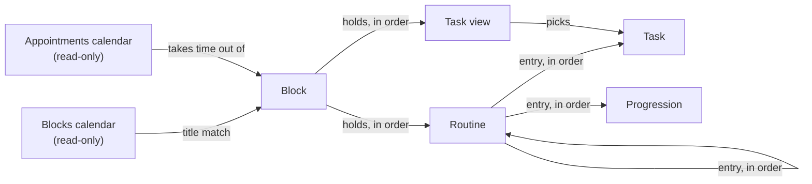
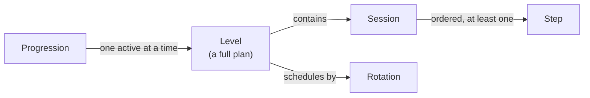
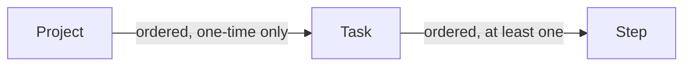
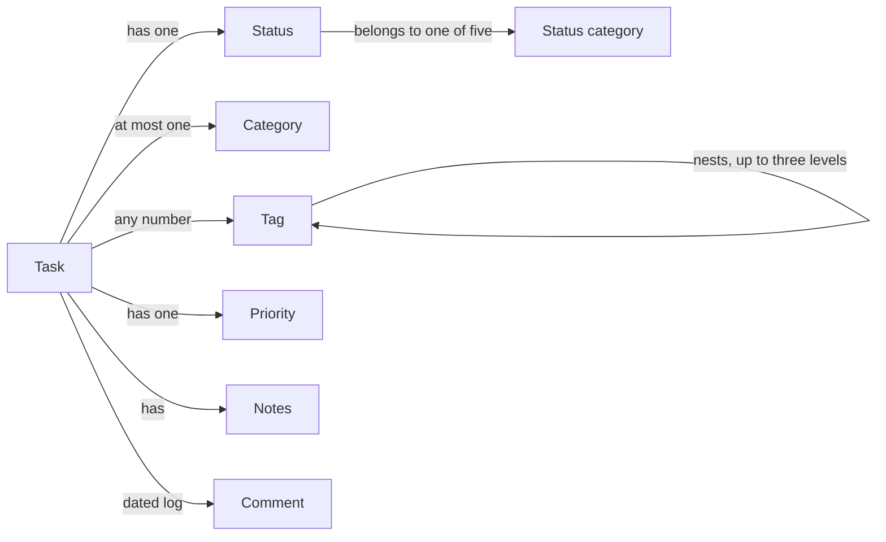
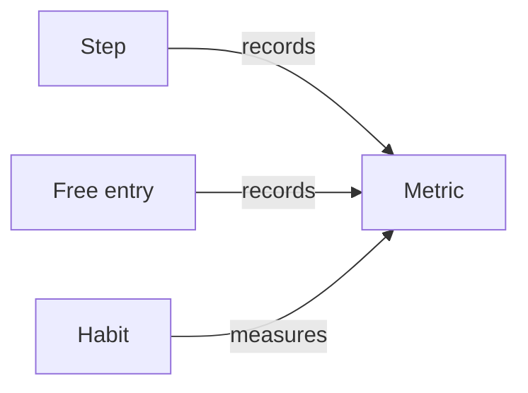
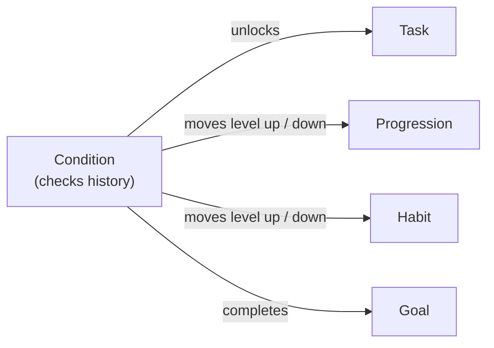
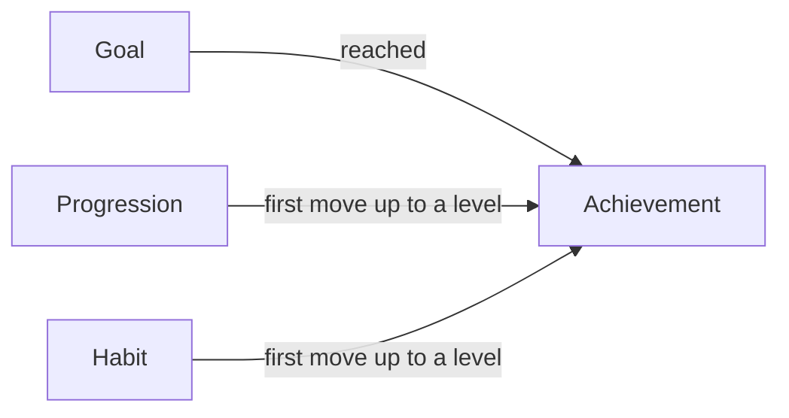

# Domain Model

The task is the center of the domain. Blocks, routines, task views, and progressions arrange tasks. Steps inside tasks record metrics. Habits measure metrics after the fact.

Each setting controls only its own behavior. No setting changes what another setting does, so Run My Day always behaves the way the setting you chose says.

## Overview

### How work reaches your day



Any routine entry can loop a set number of times.

You can also run any routine or task on demand, without the calendar.

### Inside a progression



### Inside a project and a task



Any step can loop a set number of times.

### Task fields



### Metrics and habits



### What conditions drive



### Achievements



Modes: guided or manual.

## Settled

### Calendar

The calendar holds your schedule. Run My Day reads it and never changes it.

Each connected calendar is a blocks calendar or an appointments calendar. An event on a blocks calendar starts a block. An event on an appointments calendar is an appointment, such as a dentist visit. Run My Day warns you before each appointment, and a running routine pauses during it.

An appointment takes precedence over a block. An appointment that overlaps a block takes its time out of the block, so the block has less room for work.

```text
Workout block   09:00 ------------------------------ 10:00   (60 min)
Dentist                     09:30 -------- 09:45
room for work:  45 min
```

### Block

A block attaches work to the calendar from the top down. A calendar event starts the block whose title matches the event title. The match ignores case and leading or trailing spaces.

```text
block "Morning"
"Morning", "morning", " MORNING "  -> start the block
"Mornings"                         -> no match
```

An all-day event never starts a block. A block always has a real start and end time. A block event of any length starts its block, such as a 10-minute "Stretch" event.

An event on a blocks calendar that matches no block still reserves its time: nothing runs, and the time is not free time. When the event begins, Run My Day warns you once that it matches no block.

```text
10:00-11:00 "Strech"  (no block has that title)
10:00  "Strech matches no block" -> nothing runs until 11:00
``` A block holds an ordered list of routines and task views. A block never holds a task directly.

A block starts on time and never waits for an answer. When a block starts with more work than time, Run My Day notifies you that it is overbooked and by how much, and the first step starts anyway. Steps the block does not reach stay due.

```text
Morning block 07:00-07:30 (30 min), 45 min of steps
07:00  "Morning block is overbooked by 15 minutes" -> the first step starts
07:30  block ends -> the unreached steps stay due
```

A block ends when its time is up or when its list has nothing left to run in the foreground, whichever comes first. A task waiting in the background does not keep a block open. Free time always falls outside blocks.

```text
Morning block 07:00-07:30
07:18  the list has nothing left -> "Morning ended" -> free time starts
```

A block that ended early starts again whenever its list has something to run before its event ends. A block can therefore run more than once in one event, and history records each run.

```text
Morning block event 07:00-07:30, Tidy view picks tasks tagged "Home"
07:18  nothing left -> "Morning ended" -> free time
07:22  you capture "Wipe mirror" tagged Home -> "Morning" -> Wipe mirror runs
```

A block reserves no transition time. Time inside a block is shaped only by its list and its views' limits, which block planning shows ahead of time.

A block runs its list in order. The list can hold the same task view more than once. Each time a view appears again, it continues where it left off. This interleaves views inside one block, so you don't need many small blocks on the calendar. A block can repeat its list until the block ends. A repeating block stops early when no view in its list has a task left to pick.

A task view can have a limit: a number of tasks, a number of steps, or a number of minutes. Each appearance of the view in a block ends when its limit is reached. A minutes limit ends at a step boundary, at whichever comes first: the time is up, or the next step's estimate does not fit in the time left. A step is never cut off, and a view switches early rather than run over. The first step of each appearance always starts, so a step longer than the limit still runs. A task that a limit stops partway resumes at its next incomplete step when the view appears again. A task that a limit stopped partway, and that you finish somewhere else before its view's next appearance, is passed over at that appearance. A task that a limit stopped at its view's last appearance in the block stays partly done and due.

A step that runs past a minutes limit through overtime or an extension keeps running, because a limit never cuts a step off. The appearance ends when that step ends.

A partly done task that a view continues counts toward that view's tasks limit, the same as a new task.

```text
Email view, limit 2 tasks: Invoice Joe (4 steps), Call bank, Book flight
Mon  Invoice Joe steps 1-2 done, then the block ends
Tue  Email view: Invoice Joe (steps 3-4), Call bank   -> 2 tasks, limit reached
```

A view without a limit runs until it has no more tasks to pick. A view that has no more tasks to pick is passed over.

Two views:

```text
Email view: limit 1 task       Paperwork view: limit 1 task
Admin block: Email, Paperwork, Email, Paperwork, Email, Paperwork

run:  E1  P1  E2  P2  E3  P3
```

Three views, each with its own kind of limit:

```text
Deep work view: limit 3 steps   Email view: limit 1 task   Errands view: limit 10 min
Work block: Deep work, Email, Errands, Deep work, Email, Errands

run:  D1(steps 1-3)  E1  R1 R2 (10 min)  D1(steps 4-5) D2(step 1)  E2  R3 ...
```

A minutes limit switches early:

```text
Errands view: limit 10 min

0 min   step A (4 min)
4 min   step B (3 min)
7 min   next step C is 5 min, only 3 min left -> switch now, C waits
```

When several views in a block would pick the same task, the view whose appearance reaches it first runs it. Once a task completes, no view picks it again in that block run. A skipped task stays out of every view for the rest of the block's calendar event, because a skip means "not now". This holds across restarts of the block within the same event. The task can come back in a later event of that block, or in another block.

```text
Work block event 09:00-10:00, repeating: Email view (limit 1), Urgent view (limit 1)
09:10  Email -> Reply to boss -> you skip it
       Urgent -> Fix outage
09:40  nothing left -> "Work ended"
09:45  a new task -> Work starts again; Reply to boss stays out until 10:00
```

```text
Work block, repeating: Email view (limit 1 task), Urgent view (limit 1 task)
Email sorts:  Newsletter, Invoice, Reply to boss
Urgent sorts: Reply to boss, Fix outage

round 1:  Email -> Newsletter    Urgent -> Reply to boss
round 2:  Email -> Invoice       Urgent -> Fix outage
```

A view that runs out:

```text
Paperwork view has only P1
Admin block: Email, Paperwork, Email, Paperwork, Email

run:  E1  P1  E2  E3   (Paperwork is passed over the second time)
```

### Routine

A routine is an ordered list of entries that repeats. Each entry is a task, a progression, or another routine. A routine holds no steps of its own. A routine inside a routine works as a section, such as a morning cleaning routine inside the morning routine, and lets you reuse it. A routine can belong to many blocks and many routines. A routine can never contain itself, directly or through other routines. Any routine entry can loop a set number of times, such as 4 rounds of a circuit routine.

Each routine run records its own outcome in history: complete when it reaches its end, incomplete when it stops before its end, such as at a block end.

```text
Morning routine: Shower, Pack gym bag, Vitamins
07:30  block ends during Pack gym bag
history: Shower done, Pack gym bag interrupted (3 of 5 min), Vitamins not reached
         Morning routine run: incomplete
```

A task that a stopped routine did not reach stays due. It plays at the routine's next run and shows wherever due and overdue tasks show. A routine keeps no list of leftovers.

Each entry plays only when its own schedule says:

| Entry | Plays when |
| --- | --- |
| Task with a due date, one-time or recurring | its due date is today or earlier |
| Task without a due date | every time, until you complete it |
| Progression | the active level's rotation has a session due |
| Routine | every time. Its own entries decide what plays |

```text
Morning routine, runs daily
  Water plants   repeats Mon, Wed, Fri
  Pay rent       one-time, due Dec 1

Mon  Water plants plays; you complete it -> next due Wed
Tue  Water plants does not play
Wed  Water plants plays
Dec 1  Pay rent plays, and keeps playing until you complete it
```

Loops nest. Each loop of a routine entry runs every one of its entries in order, with their own loops, all the way down to the steps. Estimates multiply the same way.

```text
Workout routine
  Circuit routine            x 3 loops
    Push-up task
      Step "10 push-ups"     x 2 loops

run order:  round 1: push-ups, push-ups
            round 2: push-ups, push-ups
            round 3: push-ups, push-ups   -> step runs 6 times
estimate:   step estimate x 2 x 3
```

### Task view

A task view is a saved filter and sort over tasks. It is the only way a task outside a routine reaches a block. A filter can include or exclude tasks that belong to a routine.

### Task

A task is the center of the domain. A task holds an ordered list of steps and always has at least one step. A task's estimate is the sum of its steps' estimates. A recurring task comes back on its own schedule.

A task can have a due date, with an optional due time. A due time follows the clock: "due Friday 02:00" means 02:00 on calendar Friday. A due date without a time lasts until your day ends: with the day starting at 4:00, "due Friday" ends at 4:00 on Saturday. A "day starts at" setting, 4:00 by default, decides which date counts as today for every day rule, such as due today and repeats. Every day rule uses the time zone stored in your settings.

```text
Day starts at 4:00. It is 1:00 on calendar Friday, and you are still up from Thursday.

"due Thu"         (no time)  -> still due today; your Thursday ends at 4:00
"due Fri"         (no time)  -> due tomorrow, your Friday
"due Fri 02:00"   (time)     -> due in 1 hour, by the clock
```

A recurring task is one task whose due date moves forward each time you complete it. A missed recurring task stays overdue until you complete it or move its due date yourself.

A recurring task's repeat builds on TickTick's repeat model. The [task settings guide](task-settings-guide.md) explains each setting with examples.

A repeat has one pattern kind:

- **Every N days, weeks, months, or years**, repeating by due date or by completion date.
- **Specific dates**, repeating by due date.

A repeat by due date sets the next due date from the old due date. A repeat by completion date sets it from when you finished.

A repeat by due date has an "if missed" setting. **Jump to today**, the default, moves the due date to the next pattern date after today. **Every date is owed** moves it to the next pattern date after the old due date.

A repeat ends never, on a date, or after a number of repeats.

A task has one status. Each status belongs to one of five fixed categories: backlog, ready, started, complete, and canceled. You can add and rename statuses inside each category. Domain rules read only the category. Task view filters can pick a single status or a whole category.

Run My Day ships these statuses:

| Category | Statuses |
| --- | --- |
| backlog | Ideas, Future |
| ready | Ready |
| started | Started, Waiting |
| complete | Complete |
| canceled | Canceled, Duplicate |

Waiting means waiting on someone else. Its due date is the follow-up date. A new task is ready. You move a task to backlog, or create it as backlog, when you don't plan to do it soon or it has no due date yet.

A task has one priority from a fixed set: no priority, low, medium, high, or urgent. A new task has no priority.

A task has at most one category and any number of tags. Categories and tags help you filter and sort tasks. Categories have an order you set. Tags have an order you set. Tags can nest up to three levels deep. A filter on a parent tag also matches tasks tagged with any tag nested under it.

```text
Home
+-- Garden
|   +-- Watering      "Water plants" is tagged Home/Garden/Watering
+-- Kitchen

filter on "Home"   -> matches "Water plants"
filter on "Garden" -> matches "Water plants"
```

A task has notes: one Markdown text that holds the current facts. A task also has comments: a dated log of entries, each of which can hold images.

A task's skip count is the number of times you skipped it since you last completed it. Run My Day computes it from history. Only skips you choose count. A block that ends before reaching a task does not raise its skip count: the task stays due, and a block that keeps running out shows the task as overbooked.

Skipping a task means "not now", for every task, one-time or recurring. A skip changes nothing on the task: its due date stays the same, and a task without one stays without one. History records the skip, and the skip count shows a task you keep avoiding. To pass an occurrence of a recurring task, you move its due date yourself.

```text
"Fix sink" (one-time, no due date), in the morning routine

Mon  you skip it  -> skip count 1, still no due date
Tue  it plays again

"Water plants", repeats Mon, Wed, Fri, due Mon

Mon  you skip it  -> still due Mon, skip count 1
Tue  overdue; it plays again
```

Tasks have no subtasks. To break work down, you split a task into several tasks in the same place.

### Project

A project is an ordered list of one-time tasks that you create as a project yourself. A project grows as you learn: you add tasks you could not foresee, reorder them, and split tasks into smaller tasks. A project never contains a recurring task. The depth is always project, then task, then step.

A project's tasks run in their set order. A later task waits for the earlier ones without any stored condition. Waiting tasks stay visible as "up next" and are never hidden. A project's estimate is the sum of its tasks' estimates.

A project can have a start date. Its tasks stay hidden until that date.

### History

History is the record of every action taken in Run My Day, such as completing a task, skipping a task, moving a due date, or logging a metric value. History belongs to no single entity.

History also records every edit to a definition, such as a change to a level, a session, or a step. Any definition as it was at any past moment therefore follows from history. Editing a definition never changes what history says about the past.

### Condition

A condition is a check against your history of completions, metric values, and dates. Unlock conditions, habits, goals, and progression levels all use the same condition concept.

### Unlock conditions

Any task, one-time or recurring, can have a list of unlock conditions. Most tasks have none: order covers the common case, and unlock conditions handle exceptions such as a dependency on a task in another project or a metric. Each task chooses whether it unlocks when all of its conditions are met or when any one of them is met. A locked task stays hidden until it unlocks. A condition can be:

- another task completed a set number of times, including once
- a metric condition

A task has no start date. A project can have one instead.

A condition lives on the thing whose state it changes. A task carries its own unlock conditions. Anything that chooses between tasks belongs to a progression.

Conditions can never be circular: no task can wait on itself.

Run My Day refuses to delete anything that an unmet condition points at, such as a level that an unreached goal points at, or a task that another task's unlock condition points at.

### Progression

A progression is an ordered list of levels. Each level is a whole training plan: a set of sessions and one rotation for them, over any span of days or weeks. For example, a push-up progression starts at 10 push-ups twice a week. It moves to four times a week, then to changing sets and reps, then to a two-week rotation of push-up types such as handstand push-ups one day and triangle push-ups another. Each level is a full plan on its own and lists all of its sessions and its rotation. Exactly one level is active at a time.

### Session

A session is a planned bout of practice inside a progression level, such as "Tree pose" or "Wide push-ups". A session has a title, steps, and an estimate, and its steps record metrics, the same as a task. A session is not a task: it has no repeat, no due date, no unlock conditions, and no place in a project or a task view. The level decides when a session is due. You can also run a session on demand.

A session belongs to exactly one level of one progression. When two levels or two progressions use the same exercise, each has its own session with its own history. Progress across them is tracked through a shared metric, such as "Tree hold, seconds".

### Rotation

A level's schedule is a rotation: an ordered list of slots, where each slot plays one of the level's sessions or is a rest day. For example, a 14-day rotation of standing postures with 2 rest days. Rotations exist only on progression levels.

A rotation starts at its first slot on the day its level becomes active. A rotation waits for you: a missed slot stays due until you do it, and every later slot shifts by a day. A rest slot passes when a day passes. A skip on a session means "not today": the rotation stays on the same slot, and history records the skip.

### Levels in your day

- The active level's sessions come due when its rotation says, and their completions count toward the progression's conditions.
- Inactive levels' sessions are hidden everywhere except the progression editor. A move back down to a level makes that level's same sessions active again.

Blocks offer chances, and schedules decide whether something plays at each chance. Blocks reserve time, and schedules decide what to do.

A progression reaches your day only through a routine. A routine entry can be a progression. That entry plays the active level's session due that day and is skipped on a rest slot. The routine itself does not change when the level changes.

Each level has move-up and move-down conditions, and the progression changes levels automatically when they pass. Sessions carry no level logic.

A level's number is its position in the progression's order. Goals and conditions point at a level itself, never at its number. Adding or reordering levels renumbers them, and each goal and condition still points at the same level. The active level stays active when levels are added around it. A move up goes to the next level in the current order. Every level stays editable, including reached levels.

```text
before                          after inserting "3x a week"
L1  2x a week                   L1  2x a week
L2  4x a week   <- active       L2  3x a week   (new)
L3  sets/reps   <- goal         L3  4x a week   <- still active
                                L4  sets/reps   <- goal still points here
```

A move up waits while the new level would not fit in the blocks that run it. The move happens once the blocks have room.

### Step

A step is a small unit of work inside a task or a session. Steps run in order. Every step has an estimate. A step can record a metric value. Metrics attach to steps, not tasks.

#### Running steps

Exactly one step is current at a time. It stays current until you confirm it done, its time runs out without "wait for done", you skip it, you start a wait on it, a view limit ends at its boundary, or an interruption stops it. You complete steps one at a time, wherever the task runs: in a routine, from a task view, or on demand.

Each step has a "wait for done" setting. In guided mode, a step without it moves to the next step when its time runs out. A step with it counts into overtime until you confirm it is done. Confirming sets the step's real end time. The last step of a task follows its own setting too, so a task whose last step does not wait for done completes when that step's time runs out.

```text
Pack gym bag, estimate 5 min, wait for done

0 -------- 5 min -------- 7:15
           countdown 0    you confirm done -> overtime +2:15, real time 7:15
```

Run My Day announces nothing when a step's countdown reaches zero. When a step without "wait for done" reaches zero, it ends and the next step starts. The only sound then is the next step's start announcement, if that step has it on. When a step with "wait for done" reaches zero, it enters overtime with no sound. The only sound in overtime is the nag, if the step has nagging on.

A step can nag you while it waits on you. Nagging is a setting on the step, off by default. Turning it on requires an interval of at least 30 seconds, 30 seconds by default. Every announcement template is limited to 200 characters, to keep each announcement under about 15 seconds of speech, so a nag always ends well before the next one is due. A step waits on you in two cases:

- **Overtime** on a step with "wait for done": each nag plays the nag announcement.
- **An unanswered metric prompt:** each nag repeats the prompt's question.

Nagging stops when the step stops waiting on you: you confirm done, answer the prompt, extend, skip, or pause.

```text
Pack gym bag, estimate 5 min, wait for done, nagging every 30 s

07:00    step starts
07:05    countdown hits 0, overtime starts
07:05:30 nag
07:06    nag
07:06:20 you confirm done -> nagging stops
```

A step can give three warnings, each its own setting on that step. Every step has its own warning settings, with no shared or inherited value:

- **Halfway:** at the middle of the step's time.
- **Time left:** a set time before the step's time runs out, any positive length.
- **Next up:** a set time before the step's time runs out, announcing the next step.

A new step starts with all three warnings off.

Each announcement's setting lives on the thing it announces:

| Announcement | Setting lives on |
| --- | --- |
| Block start | the block |
| Overbooked | the block |
| Block-end warning | the block, with a lead time of any positive length |
| Block end | the block |
| Resuming | the task |
| Step start | the step |
| Routine start | the routine |
| Routine complete | the routine |
| Free time | your app settings, because free time belongs to no block |

Announcements never overlap. Every announcement plays, one after another, in a predictable order. One that falls due while another plays waits for it. Announcements due at the same moment play in this order: block end, block start, overbooked, routine complete, routine start, resuming, step start, block-end warning, time left, halfway, next up, nag.

```text
Stretch, 10 min, halfway on, time left 5 min; the block ends at 07:30

07:25  three fall due at once -> 1. block-end warning
                                 2. "5 minutes left"
                                 3. "Halfway through Stretch"
```

Every announcement's text is a template you can edit. Each announcement offers its own variables:

| Announcement | Variables | Default template |
| --- | --- | --- |
| Block start | block name, end time | "{block name}" |
| Overbooked | block name, minutes over | "{block name} is overbooked by {minutes over}" |
| Block-end warning | block name, time left | "{block name} ends in {time left}" |
| Block end | block name | "{block name} ended" |
| Routine start | routine name, estimate | "{routine name}" |
| Routine complete | routine name | "{routine name} complete" |
| Resuming | task name | "Resuming {task name}" |
| Step start | step name, estimate, task name | "{step name}, {estimate}" |
| Halfway | step name | "Halfway through {step name}" |
| Time left | step name, time left | "{time left} left" |
| Next up | next step name | "Next: {next step name}" |
| Nag | step name, overtime | "{step name} is over time" |
| Loop number | loop number, loop total | "{loop number} of {loop total}" |
| Free time | end time, next event | "Free time until {end time}, then {next event}", or "Free time for the rest of the day" when nothing follows |

A looped step or a looped routine entry has a loop number announcement, its own setting on that step or entry, on by default. It plays at the start of each loop.

```text
Step "10 push-ups", x 3 loops, template "Push-ups {loop number} of {loop total}"

07:00  "Push-ups 1 of 3"
07:02  "Push-ups 2 of 3"
07:04  "Push-ups 3 of 3"
```

A step has a start sound setting: none, or a sound you pick. A new step has none. When a step has a start sound, it plays at the step's start, and the step start announcement follows it. The first sound of a step, whichever it is, plays on the step's start mark. Run My Day ships a set of sounds to choose from.

```text
Plank hold, 4 s, x 5 loops, start sound "soft chime"

0.000 s  soft chime         <- first sound, on the mark
0.150 s  "Plank 1 of 5"
4.000 s  soft chime
4.150 s  "Plank 2 of 5"
```

A new block starts with block start, overbooked, and block end on, and with the block-end warning on, 5 minutes before the end. The free time announcement is on by default. A new routine starts with routine start and routine complete on. A new task starts with resuming on. A new step starts with its step start announcement on.

A task that returns to the foreground partway through plays its resuming announcement, then its next step's start announcement, each by its own setting. This happens when a view appears again and continues the task, when a waiting task returns, and when an interrupted step resumes.

```text
Work block list: 1. Deep work view (limit 3 steps)  2. Email view (limit 1 task)  3. Deep work view
09:00  Deep work: Write report steps 1-3, then the limit is reached
09:30  Email: "Reply to Sam"
09:35  Deep work again: "Resuming Write report", then "Draft, 30 minutes"
``` A step with step start, all warnings, and nagging off is silent: it starts and runs without a word.

```text
Workout routine, guided
  Squats            step start on    "Squats, 5 minutes"
  Put weights down  step start off   (silent 30-second filler step)
  Lunges            step start on    "Lunges, 5 minutes"
```

```text
07:00  "Morning block"               block start, set on the block
07:00  "Morning routine"             routine start, set on the routine
07:00  "Shower, 10 minutes"          step start, set on the step
07:15  "Morning routine complete"    routine complete, set on the routine
08:00  "Free time until 09:00"       set in app settings
```

```text
Write report, step "Draft", 30 min, next step "Review"

07:00  start
07:15  halfway     "Halfway through Draft"
07:25  time left   "5 minutes left"
07:29  next up     "Next: Review"
07:30  end
```

Confirming done before a step's time runs out ends the step early, records its real time, and starts the next step.

```text
Dishes, estimate 10 min

0 ------ 6 min ------ 10 min
         you confirm done -> real time 6 min, next step starts now
```

#### Extend

Extend adds time to the current step's countdown for this run only. The step's estimate does not change. Its real time, including the extension, still feeds learned estimates. An extension can be any positive length, in seconds, minutes, or hours. Extending a step in overtime gives it that much time from now. When an extension runs out, the step follows its own nagging setting, with no extra announcement.

```text
Pack gym bag, estimate 5 min, wait for done

0 ------ 5 ------ 7 min      at +2:00 overtime you extend by 5 min
                  |--- 5 ---| countdown ends at 12 min
```

#### How a task ends

A step ends as done or skipped. An interrupted step is not ended: it resumes later. A task completes once every step is done or skipped and at least one step is done. A task whose every step was skipped counts as skipped, not complete. Skipping a task skips all its remaining steps at once, and the task then ends by the same rule. A task completes only through its steps, so every completion keeps its step statistics. A skip is an explicit choice, so history keeps it. A skipped step records no real time and does not feed learned estimates.

```text
Clean kitchen
  [x] Dishes     done
  [x] Counters   done
  [ ] Floor      <- you skip the task: Floor is skipped
                    2 done + 1 skipped -> task complete

Clean kitchen
  [-] Dishes     skipped
  [-] Counters   skipped
  [-] Floor      skipped  -> no step done -> task skipped
```

A partly done task is a state, not an outcome. A task keeps its completed steps when a run stops partway, and its next run starts at its first step that is not complete. A partly done task counts only its incomplete steps toward a block's room. When a recurring task completes, its steps start fresh for the next due date.

```text
Clean kitchen (estimate 25 min)
  [x] Dishes     10 min
  [x] Counters    5 min
  [ ] Floor      10 min   <- next run starts here; counts 10 min toward block room
```

#### Pause

You can pause at any time. While paused, all sound from Run My Day stops, except a wait step with "interrupt when done": its end breaks through the pause. Confirming done or skipping while paused ends the pause, and the next step starts at once. Paused time does not count toward a step's elapsed time or toward a view's minutes limit.

```text
Dishes, estimate 10 min

0 ---- 4 min [paused 6 min] ---- resume at 4 min elapsed, 6 min left
```

A pause can have a length, any positive length in seconds, minutes, or hours. A timed pause ends by itself, and the run resumes.

An appointment pauses a running routine with the same kind of pause. The pause lasts until you resume, even after the appointment ends.

```text
Dishes running, 4 min elapsed
09:30  Dentist starts  -> paused; all sound stops; elapsed stays 4 min
09:45  Dentist ends    -> still paused until you resume
```

A block-end warning that falls due during a pause plays when you resume, with the time actually left. If the block ends before you resume, Run My Day says the block ended instead.

```text
Morning block ends 07:30, warning at 07:25
07:20  you pause
07:25  warning due -> silent
07:27  you resume -> "Morning ends in 3 minutes"

07:20  you pause
07:30  block ends during the pause -> "Morning ended"
```

A block that ends during a pause ends the pause and interrupts the step, the same as a running step.

```text
Workout block ends 10:00
09:50  you pause during Squats, 3 of 5 min elapsed
10:00  block ends -> pause ends; Squats is interrupted with 3 min elapsed
                     and resumes the next time it runs
```

```text
10:00  pause for 10 minutes
10:10  pause ends by itself -> Dishes resumes
```

#### Undo

Undo reverses your latest done or skip of a step, with no time limit. Only the latest one can be undone. The undone step's countdown continues as if the done never happened. The step that started after it goes back to not started, and its start is removed. Undoing a skip also takes it out of the skip count. Undo after the block ended starts nothing: the step goes back to not done. History records the undo itself as an action.

```text
09:00  Dishes starts
09:06  you confirm done by mistake   -> Counters starts
09:07  undo                          -> Dishes is current again, 7 min elapsed
                                        Counters back to not started, its start removed
```

#### Waits

A wait step is a kind of step that sits between two steps of a task, such as "Dry, 90 min" between "Load dryer" and "Fold". A wait step always has a normal step after it in the same task, so a task can never end with a wait step. For example, "Run dishwasher" ends with "Unload dishwasher" after the "Dishwasher runs, 60 min" wait step. It differs from a normal step in these ways:

| | Normal step | Wait step |
| --- | --- | --- |
| Runs in | the foreground, as the current step | the background, while the block runs other work |
| Needs you | yes | no |
| Ends | done, time runs out, or skip | only when its time runs out |
| Pause and appointments | its timer stops | its timer keeps running |
| After it ends | the next step starts at once | the next step returns at the next step boundary |

When a wait step starts, its task goes to the background, and Run My Day runs the block's other work in the foreground. When the wait step's time runs out, the task returns at the next step boundary: the current step is never cut off. The task plays its resuming announcement, and its next step becomes the current step. A wait step's timer keeps running through pauses and appointments, because it tracks something in the real world, such as a dryer. A wait step that ends during a pause returns its task when you resume.

```text
Laundry task
  Load washer   step, 5 min
  Wash          wait step, 45 min
  Load dryer    step, 5 min
  Dry           wait step, 90 min
  Fold          step, 10 min

09:00  Load washer starts
09:05  Load washer done -> Wash starts, Laundry goes to the background
       the block runs its next item: Tidy view, "Wipe counters"
09:50  Wash ends while "Wipe counters" is running
09:52  "Wipe counters" ends -> "Resuming Laundry", "Load dryer, 5 minutes"
       Load dryer becomes the current step
09:57  Load dryer done -> Dry starts, dryer done at 11:27
10:10  you pause
10:30  you resume
11:27  Dry ends on time -> Fold is ready
```

A wait step has an "interrupt when done" setting, off by default. With it off, the task returns at the next step boundary. With it on, the wait step's end interrupts the current step at once. The interrupted step keeps its elapsed time and resumes later, as with any interruption.

```text
"Ride" wait step, 12 min, interrupt when done
09:00  ride wait starts
09:05  "Write email" starts, 10 min
09:12  ride wait ends -> "Write email" is interrupted with 7 min elapsed
       the ride task's next step starts: "Go outside"
```

An interrupting wait step that ends during a pause, including an appointment's pause, breaks through it at once.

```text
09:00  "Ride in 45 minutes", interrupt when done
09:30  Dentist starts -> paused, all sound stops
09:45  ride wait ends -> "Ride is here" plays now, during the appointment
```

You can extend a wait step like any other step, such as when the ride is running late. Extending a wait step adds time to it for this run only.

A waiting task returns at the next step boundary wherever you are, even after its block has ended: in free time, in another block, or in an on-demand run.

```text
Housework block 09:00-10:00
09:57  Dry starts, ends 11:27
10:00  block ends; Laundry stays in the background
11:27  Dry ends during the Work block -> at the next step boundary,
       "Resuming Laundry", and Fold runs
```

Wait steps take no foreground time, so they do not count toward a block's room. Only normal steps count.

```text
Housework block, 60 min: Laundry task, Tidy view (40 min of tasks)
Laundry: Load washer 5 + Wash (wait) 45 + Load dryer 5
block room used: 5 + 5 + 40 = 50 min -> fits, 10 min spare
```

When several waiting tasks are ready at the same step boundary, they return in the order their wait steps ended. Wait steps that ended at the same moment return in the order of the block's list.

```text
Laundry: Dry ends 10:30     Dinner: Roast ends 10:31
10:33  "Wipe counters" ends -> Laundry's Fold first, then Dinner's next step
```

When a task is waiting and the block has nothing else to run, the block ends and free time starts. Run My Day announces the free time with the time the waiting task is ready. When the wait step ends, the task's next step starts at once, because no step is running.

```text
Housework block 09:00-11:00: Laundry routine, Tidy view
09:57  Dry starts, ends 10:30
10:05  Tidy view has nothing left -> "Housework ended" -> "Free time until 10:30"
10:30  Dry ends -> Fold starts, outside the block
```

You can start a wait at any time, even in free time with no task running. Run My Day then creates a one-time task, the same way quick capture does. The task holds the wait step and one normal step after it, named from what you said. The wait step's settings, such as "interrupt when done", are set the same way as on any wait step.

```text
10:05  free time; you say "ride in 12 minutes", interrupt when done
       -> one-time task "Ride": wait step 12 min -> step "Ride is here"
10:17  the wait ends -> "Ride is here" interrupts whatever is running
```

You can also make the current step wait, for any length you choose. Run My Day inserts a temporary wait step of that length before the current step, and the task goes to the background. When the wait step ends, the current step returns with its elapsed time, and the temporary wait step is deleted. History keeps the record of it. A wait is not a skip: the skip count does not change.

```text
"Call dentist" task:  Call
you wait 30 min    ->  [wait 30 min, temporary]  Call     background
30 min later       ->  Call returns at the next step boundary; the temporary wait step is deleted
```

#### Interruptions

A step tracks how much time has elapsed in it. A block end, an appointment, your own stop, or a wait step with "interrupt when done" can interrupt a running step. A view limit never does. A step that is running when its block ends stops at the block end. An interrupted step resumes later with its elapsed time, and its time left is its estimate minus its elapsed time. Every fit check uses a step's time left, not its full estimate. A loop's real time, which learned estimates use, is its total elapsed time across interruptions, without the time it sat paused. History records each interruption.

```text
Write report, step "Draft" (estimate 30 min)

Mon  Work block ends at 12 min   -> Draft stops, 12 min elapsed, 18 min left
Tue  Work block starts           -> Draft resumes at 12 min
     done at 31 min total        -> real time for learning: 31 min
```

#### Loops

A step can loop a set number of times, such as 3 sets of 10 push-ups. A step's estimate covers one loop. A looped step or a looped routine entry counts as its estimate multiplied by its loop count.

```text
Step "10 push-ups", estimate 2 min, x 3 loops -> counts as 6 min
```

#### Learned estimates

A step can learn its estimate. With learning on, a step's estimate is a trimmed average of the real times of its latest 5 completed loops: Run My Day drops the highest and the lowest time and averages the rest. Learning starts once a step has at least 3 completed loops. A task's or session's estimate stays the sum of its steps' estimates.

| Completed loops | Real times (min) | Kept | Estimate |
| --- | --- | --- | --- |
| 3 | 8, 10, 40 | 10 | 10 |
| 4 | 8, 10, 12, 40 | 10, 12 | 11 |
| 5 | 8, 9, 10, 12, 40 | 9, 10, 12 | 10.3 |

### Metric

A metric is a measured value. A step can record a metric value. You can also add, edit, or remove metric entries directly.

Each metric on a step has one recording mode:

| Mode | When the step is done |
| --- | --- |
| Automatic | records a fixed value with no question, such as 10 push-ups |
| Prompt | asks for the value and waits for your answer |

```text
Step "Push-ups", metric "push-ups", mode Prompt
07:02  you confirm done
07:02  "How many push-ups?"
07:02  you say "12"  -> records 12
07:02  "Squats, 2 minutes"  -> the next step starts only now
```

With nagging on, an unanswered prompt repeats:

```text
Push-ups, nagging on, every 30 s
07:02     "How many push-ups?"
07:02:30  "How many push-ups?"
07:02:40  you say "12" -> records 12, nagging stops, next step starts
```

Steps record metrics. Loops do not. A step records its metrics every time it ends. Looping repeats the step, and each repetition ends the step, so each repetition records. With an Automatic metric, every repetition records the same fixed value. With a Prompt metric, each repetition can record a different value.

```text
Step "10 push-ups", x 3 loops, metric "push-ups", mode Prompt
step ends (1st) -> "How many push-ups?" 10
step ends (2nd) -> "How many push-ups?" 9
step ends (3rd) -> "How many push-ups?" 7    -> 3 entries
```

A step records its metrics however it ends: when you confirm done, or when its time runs out without "wait for done". The next step starts only after every metric of the step is recorded. You answer a prompt only by giving the value, never with a combined command.

### Habit

A habit measures unplanned behavior after the fact. You log it when it happens, such as logging 24 oz each time you finish a water bottle. A habit's metric values come mostly from free entries, and sometimes from steps in tasks. A habit creates no tasks. A habit updates automatically from metric values. You never tick off a habit directly.

A habit can nudge you during the day based on how you are doing against its target, such as "30 of 60 oz, and it's 3 pm". Each habit sets how often it nudges, including never.

A habit differs from a progression in when the doing happens. A habit tracks behavior that life triggers. A progression plans scheduled work as tasks.

A habit can have levels. Each level sets a higher target, and conditions move the habit up or down automatically. For example, a water habit starts at 60 oz a day. After 7 days in a row at or above the target, it moves to 70 oz, then 80 oz, then 100 oz, which is the top level. A habit stays at its top level once it gets there. A habit level's number is its position. Goals and conditions point at a habit level itself, never at its number.

A habit measures its target over a sliding window of N days, weeks, months, or years. For example, "gym 3 times in any 7 days".

Each day passes or misses, based on the window that ends that day. The streak is the number of passing days in a row. The percentages are the share of passing days.

A habit shows:

- its current streak
- the percentage of successful days this week, this month, and this year

A level change never breaks a streak. Any day the target is not met breaks the streak.

A habit never finishes. Archiving a habit stops tracking. Unarchiving it shows its full history again, because Run My Day computes that history from the metric values.

### Goal

A goal is reached once and is then done. It completes the first time its conditions pass. A deadline is optional: some goals are for a lifetime. A goal with a deadline shows its pace: ahead, on track, or behind.

### Achievement

An achievement is a reached goal or a level move up in a progression or a habit. A goal becomes an achievement when its conditions pass. A move up becomes an achievement only the first time it reaches that level.

```text
Nov 1   L2 -> L3   achievement "Reached L3"
Nov 10  L3 -> L2   (move down)
Nov 20  L2 -> L3   no new achievement; history records the move
``` Each achievement has a trophy image. An achievement shows the conditions that were met, the history records that met them, and the level or goal as it was when reached.

Run My Day ships built-in goals with fixed conditions, such as a 30-day streak. A reached built-in goal becomes an achievement in the same way as your own goals.

### Modes

- **Guided mode:** the clock and your rules advance the day. Guidance comes through your choice of voice, sound cues, music cues, vibration, notifications, or silence.
- **Manual mode:** nothing advances by itself. You start and finish everything. Manual mode is also the way to take back control when the system gets something wrong.

You can start any routine or task on demand, outside the calendar, in either mode. Run My Day works without a blocks calendar.

### Unscheduled tasks

A task or session is unscheduled when Run My Day cannot show that it will get done by its due date. It is unscheduled in any of three ways:

- **No block:** no block's task view or routine can ever pick it.
- **Not on the calendar:** a block could pick it, but no event for that block comes before its due date.
- **Overbooked:** block events before its due date pick it, but the work ahead of it fills those events before it is reached.

Run My Day checks all three for each task that is overdue or due within the next 7 days. It checks a task without a due date only for no block. It checks a task due later than 7 days once its due date comes within 7 days. For an overdue task, "before its due date" means within the next 7 days. For a task in a project with a start date, only block events between the start date and the due date count. Run My Day skips a task that waits on a task or metric condition until it unlocks. It never checks a task in the backlog category, because a backlog task is intentionally not active.

```text
today: Nov 1                     Nov 8 (+7 days)
|--------------------------------|
  Renew tag, due Nov 4    -> checked: a block must reach it by Nov 4
  Pay rent, due Nov 20    -> not yet; checked from Nov 13
  Overdue: Call Joe       -> checked: a block must reach it by Nov 8
  Fix sink, no due date   -> checked for "No block" only
```

### Free time

Free time is time with no block running, no appointment, no unmatched block event, and no on-demand run. Run My Day announces each stretch of free time with its end and the next event, or as "for the rest of the day" when nothing else is on the calendar. Free time starts nothing on its own, not even due or overdue tasks. The only work that runs in free time is a waiting task returning to run its next step, or something you start on demand.

```text
07:00-07:18  Morning block runs
07:18-08:00  free time   "Free time until 08:00, then Work"
08:00-09:00  Work block
09:00-09:30  Dentist, an appointment, not free time
09:30-       free time   "Free time for the rest of the day"
```

### Transitions

Work runs in small steps, so nothing gets cut off midway. Before something ends, Run My Day tells you what comes next and asks you to wrap up and leave the work in a good state. Run My Day encourages this practice and never enforces it.

